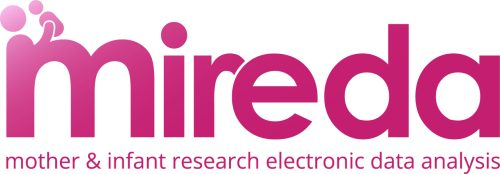

# MIREDA Partnership

## Mother and Infant Research Electronic Data Analysis (MIREDA)

The **MIREDA Partnership** is a UK-wide collaboration that harmonises electronic birth cohorts into a common data model to enable **federated, reproducible life-course research** across nations and Trusted Research Environments (TREs).

The partnership brings together major maternal and child health datasets from England, Wales, and Scotland, transforming them into the **OMOP Common Data Model (CDM)** to support consistent, cross-cohort analyses while data remain securely within their host environments.

Together, the harmonised cohorts represent over 18 million births, enabling research into rare exposures, policy impacts, and long-term health outcomes across the life course.

Visit our:
- Preprint [Data Resource Profile](https://doi.org/10.64898/2026.03.23.26349078).
- [Protocol paper](https://ijpds.org/index.php/ijpds/article/view/2406)
- [Continuously updated, detailed protocol](https://dx.doi.org/10.17504/protocols.io.36wgq2b3ogk5/v1) - *Not yet available*
---

## About the Project

MIREDA is funded by the UK Medical Research Council and brings together five major electronic birth cohorts:

- Born in Wales  
- Born in Scotland  
- Born in Bradford  
- Born in South London (eLIXIR)  
- Clinical Practice Research Datalink (CPRD) birth cohorts  

Each cohort remains within its own secure TRE, but harmonisation into OMOP enables:

- Federated analysis without sharing raw data  
- Reproducible analytical pipelines  
- Cross-nation and international comparisons  
- Large-scale studies of rare exposures and outcomes  

---

## Purpose of This GitHub Organisation

This GitHub organisation provides open technical resources developed by the MIREDA partnership, including:

###

### 1. ETL Scripts
- Scripts used to run the tools MIREDA employed in their ETL processes.
- Scripts which may have been needed for pre- or post-processing in order to circumvent any limitations in the methods/tools used.

### 2. OMOP Mappings
- Contains a subdirectory for each birth cohort in MIREDA.
- Each subdirectory contains JSON and CSV files which outline the mapping rules used by each cohort for their OMOP transformation.

### 3. Analysis Scripts
- A place for our MIREDA analysts to share any useful or common analysis scripts that process the MIREDA OMOP CDM data.

### Projects using MIREDA
- Other repositories within the MIREDA organisation reflect other projects we are involved with using the MIREDA data resource.
- These are also outlined in the **Projects** section above.
---

## Accessing the Data

The metadata for the harmonised MIREDA datasets are summarised the **Health Data Research UK Gateway**:

[https://healthdatagateway.org/en/collection/119](https://healthdatagateway.org/en/collection/119)

Data are not held centrally. Each cohort:

- Remains within its own Trusted Research Environment
- Is governed by local data controllers
- Requires separate access approval

Federated analysis enables the same code to run across all sites without moving sensitive data.

Work is currently underway to pilot a federated platform held within the SAIL Databank.

---

## Getting Started

1. Explore repositories for:
   - Mapping specifications
   - ETL pipelines
   - Analytical examples

2. Review documentation for:
   - OMOP structure in birth cohorts
   - Mother–infant linkage methods
   - Harmonisation decisions

3. Contact us to apply to work with our data and discuss ideas at [mireda@jiscmail.ac.uk](mailto::mireda@jiscmail.ac.uk).
---

## Citation

If you use MIREDA resources, please cite:

Seaborne et al.  
*UK electronic birth cohort data harmonisation using a common data model*  
(Final publication details to be added once available.)

---

## Funding

Funded by the **UK Medical Research Council (MRC)**  
Partnership Grant: **MR/X02055X/1**

---

## Contact

**MIREDA Partnership**  
Centre for Population Health  
Swansea University Medical School  

Project pages:  
https://gtr.ukri.org/projects?ref=MR%2FX02055X%2F1  
https://centreforpopulationhealth.org/projects/mireda/

---

## Licence

Unless otherwise stated, code in this organisation is released under an open-source licence.  
See individual repositories for licence details.
